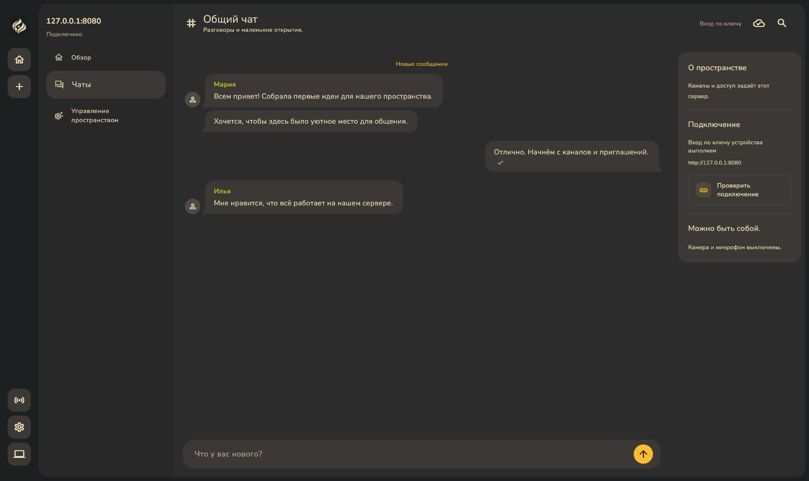

# Space App

Общее Flutter-приложение Space: общение и управление независимыми серверами в одном интерфейсе.

- [Установщики и релизы](https://github.com/space-protocol-project/space-app/releases).
- [Руководство приложения](docs/APPLICATION-GUIDE.md).
- [Домашний сервер — «Выйти в эфир»](docs/HOME-SERVER.md).
- [Перенос пространства на другой компьютер](docs/SPACE-TRANSFER.md).
- [Полный перенос всего устройства из настроек](docs/DEVICE-TRANSFER.md).
- [Перенос отдельного домашнего пространства и рабочего состояния MLS](docs/FULL-MIGRATION.md).
- [Диск, резервные копии и безопасная очистка](docs/HOME-DISK.md).
- [Управление сервером](docs/ADMIN-GUIDE.md).
- [Голосовые комнаты и настройки звука](docs/VOICE-ROOMS.md).
- [Профиль участника пространства](docs/PARTICIPANT-PROFILES.md).
- [Лента публикаций](docs/FEED.md).
- [Непрочитанное в ленте и результаты выпуска](docs/FEED-READ.md).
- [Поиск внутри форума и ленты](docs/COMMUNITY-SEARCH.md).
- [Сводка: требует внимания и новое в сообществах](docs/DASHBOARD.md).
- [Совместимый выпуск поиска и сводки](docs/COMMUNITIES-RELEASE.md).
- [Сервер и runtime](https://github.com/space-protocol-project/space-server).
- [Протокол, архитектура и промосайт](https://github.com/space-protocol-project/space-protocol).

Опубликован клиент [v0.7.26+56](https://github.com/space-protocol-project/space-app/releases/tag/v0.7.26), совместимый с runtime **v0.7.20**, схемой PostgreSQL **37** и голосовым профилем **3**. Участник задаёт уникальное имя и аватар для всего пространства; настройки телефона доступны в нижней панели. Прежний API профиля удалён без адаптера: обновите приложение и сервер вместе. Перед обновлением сохраните резервную копию пространства и ключей MLS; откат схемы 37 требует восстановления совместимой копии. [Изменения](Changelog.md), [проверки выпуска](docs/PARTICIPANT-PROFILES-RELEASE.md).

[Результаты выпуска отметок чтения](docs/FEED-READ.md): CI, опубликованные установщики и контрольные суммы. Предыдущие пары: [поиск и сводка v0.7.20 / v0.7.16](docs/COMMUNITIES-RELEASE.md), [первый срез ленты v0.7.19 / v0.7.15](docs/FEED-RELEASE.md).

На [сайте](https://space-protocol-project.github.io/space-protocol/#interface) можно выбрать светлую или тёмную тему снимков. Основные экраны промогалереи можно воспроизвести в обеих темах: задайте `SPACE_SITE_GALLERY_OUTPUT` и запустите из `client` `flutter test test/site_gallery_test.dart`. Это снимки полного SpaceShell с демонстрационной сессией, полученные widget-тестами.

## Возможности

Android: установите `Space-android.apk` из выпуска. Мобильное приложение
подключается к пространствам по ссылке или QR (камера либо изображение),
поддерживает чат и управление. Создание домашнего сервера доступно только
на Windows, macOS и Linux. Обновления Android устанавливаются новым APK,
подписанным тем же ключом.

При открытии приложения показывается общая сводка по сохранённым серверам. У каждого сервера — отдельная вкладка-иконка слева, свой список каналов, права и сессия. Dashboard суммирует доступные каналы и непрочитанные; переключение сохраняет черновики и соединения других пространств.


Снимок Flutter-виджетов v0.2.2 с двумя демонстрационными серверами, обновлён 14 октября 2026 года. [Все десять экранов](docs/SCREENSHOTS.md). Вложения доступны в чатах начиная с v0.3.0. Лента и медиа остаются будущими этапами; форум доступен с v0.7.13; снимок отражает прежнюю версию интерфейса.

Чат, автоматическое обновление каналов и прав, непрочитанные сообщения, настройки, каналы/ACL, участники, приглашения, устройства, recovery-карточки и сопряжение. Локализация: русский, упрощённый китайский и английский для оболочки, обзора, поиска, личных настроек, основных элементов подключения, чата и домашнего запуска; настройки сервера, назначение владельца и выдача разрешения устройству также переведены. Каналы и редактор прав также переведены; смена языка сохраняет несохранённые названия и ACL. Участники, роли и блокировка также переведены; смена языка сохраняет поиск и несохранённые изменения. Приглашения также переведены: создание, срок, число использований, копирование и отзыв. Устройства, разрешения и отзыв доступа также переведены. Общие формы восстановления, сопряжения, смены ключа и QR-камеры также переведены. Сообщения операций и подтверждения восстановления, сопряжения и смены ключа также переведены. Низкоуровневые ошибки криптографии, запуска и сервера пока требуют отдельного перевода.

«Выйти в эфир» устанавливает проверенный runtime из `space-server`, создаёт собственную PostgreSQL и сертификат для статического IPv4, назначает владельца локально и открывает управление в этом же приложении. После запуска кнопка становится «Отключиться». Повторный запуск использует тот же сервер и данные. Для друзей нужен проброс TCP 8443 и разрешение брандмауэра.

## Разработка



Оболочка по согласованному концепту: кнопки пространств без фоновой панели, скруглённый слева список каналов с прямым стыком чата, компактная карточка справа и входящие/исходящие пузырьки. Снимок получен из настоящих Flutter-виджетов с демонстрационными данными, а не из работающего сообщества. Палитры, логотип и локальные шрифты сохранены. Снимок иллюстрирует интерфейс с демонстрационным разговором.

Flutter 3.47.8 и входящий в него Dart 3.13.7 (Flutter закреплён в CI). Используем свежие стабильные совместимые версии; [результаты обновления и ограничения зависимостей](docs/DEPENDENCY_UPDATES.md). Из каталога `client`:

```powershell
flutter pub get
dart run build_runner build
flutter run -d windows
flutter analyze --no-pub
flutter test --no-pub
```

Общие пакеты находятся в `packages/`. Исходники сервера здесь не дублируются. Протокол лежит в `space-protocol`; сгенерированные Dart bindings сохраняются в `client/lib/src/generated`. Из корня этого репозитория генерация: `buf generate ../space-protocol/protocol/proto --template client/buf.gen.yaml`.

Состояние приложения организовано через BLoC/Cubit; в текущих исходниках 14 моделей состояний генерируются Freezed, включая ленту, её черновики и управление. [Правила читаемости и проверки](docs/READABILITY.md), [аудит и результаты рефакторинга от 23 октября](docs/READABILITY_AUDIT.md).

## Публикация

В [клиенте v0.7.16](https://github.com/space-protocol-project/space-app/releases/tag/v0.7.16) и [runtime v0.7.13](https://github.com/space-protocol-project/space-server/releases/tag/v0.7.13) добавлены жалобы на темы и ответы, очередь модерации и решения с причиной и аудитом. Данные заявителя не возвращаются модераторам; сервер проверяет права и ограничивает повторные жалобы. [Возможности и ограничения](docs/FORUM.md), [15 снимков полного работающего приложения](docs/screenshots/forum-reports-app/README.md).

В клиенте v0.7.19 каталог «Эфира» закрепляет опубликованный runtime v0.7.15 для Windows x64, Linux x64 и macOS arm64. Архивы, дескрипторы, размеры и SHA-256 полностью проверены. Сначала обновите клиент, сохраните резервную копию пространства и ключей MLS, затем примените обновление сервера. Схема PostgreSQL — 31, голосовой профиль — 3; бинарный откат к схеме 30 требует восстановления копии. Форум и лента доступны серверу без MLS/E2EE; уже скачанные копии не отзываются.

Первый срез ленты milestone «Сообщества» **опубликован в паре v0.7.19 / v0.7.15**: хронология, комментарии, вложения, раздельные права, жалобы и модерация. Сервер объявляет `core.feed.v1`, используется схема 31. [Возможности, проверки и ограничения](docs/FEED.md), [снимки полного Windows-приложения](docs/screenshots/feed-app/README.md). Android входит в выпуск; проверка на физическом устройстве отложена по решению пользователя. Поиск, уведомления, редактирование, personas и несколько коллекций внутри одного канала остаются отдельными задачами.

[Результаты проверки форума на Windows](docs/FORUM-CHECKS.md) и воспроизводимый стенд `tools/check_forum_windows.ps1`. Для ленты используется параметр `-Scenario feed`; контракт и правила доступа — [ADR-046](../space-protocol/docs/adr/046-feed.md).

В боковой панели — чаты, комнаты и обсуждения с едиными отступами и подстройкой длинных заголовков. Управление пространством, избранное и файлы находятся в «Обзоре». Плавные переходы сохраняют черновики и учитывают системное отключение анимаций. Поле ответа общее с чатом: эмодзи, вложения и отправка; подсказка «Что у вас нового?» убрана.

| Система | Скачать последнюю версию |
| --- | --- |
| Windows 10/11 x64 | [Установщик EXE](https://github.com/space-protocol-project/space-app/releases/latest/download/Space-Setup-windows-x64.exe) |
| macOS Apple Silicon | [Образ DMG](https://github.com/space-protocol-project/space-app/releases/latest/download/Space-macos-arm64.dmg) |
| Linux x64 | [Установщик RUN](https://github.com/space-protocol-project/space-app/releases/latest/download/Space-linux-x64.run) |
| Android | [Подписанный APK](https://github.com/space-protocol-project/space-app/releases/latest/download/Space-android.apk) |

[SHA-256 установщиков](https://github.com/space-protocol-project/space-app/releases/latest/download/SHA256SUMS.txt). Ссылки автоматически ведут на последний публичный выпуск. Отдельная подпись манифеста настольного обновления не используется; загрузка проверяется по размеру и SHA-256. Android APK подписывается ключом выпуска, и обновление требует сохранения этой подписи. В установленной Windows-копии приложение запускает установщик и перезапускается после обновления. [Как обновить](docs/APP-UPDATES.md), [как восстановить домашний сервер](docs/HOME-RECOVERY.md).

В срезе v0.7.13 локально прошли 777 Flutter-тестов (19 штатных пропусков), анализ клиента и пакета управления, проверка COG ≤ 15, Windows Debug и hot reload. Стенд с 32 настоящими WebRTC-соединениями проверил все 992 направления RTP, отказ лишнему участнику и повторное использование места. Это не приёмка разговора 32 людей на реальных устройствах через интернет. [Аппаратные проверки голоса и их границы](docs/VOICE-ROOMS.md).

Для v0.7.16 локально прошли 795 Flutter-тестов (21 штатный пропуск), анализ и проверка COG ≤15. После закрепления runtime прошли ещё пять тестов каталога, установки и перезапуска. Полный Go-прогон с PostgreSQL, права и scope, жалобы, решения, аудит, защита файлов, гонки и миграция 29→30 прошли. Windows Debug запущен с настоящим сервером и двумя участниками; подготовлены 15 снимков полной оболочки. Релизные CI и установка опубликованного runtime на трёх ОС подтверждены выше.

Тег `vX.Y.Z` запускает проверки и сборку Windows Setup, macOS DMG, Linux RUN и подписанного Android APK. CI публикует выпуск только после успешных сборок и проверок; описание берётся из одноимённого раздела [Changelog.md](Changelog.md), вместе с установщиками публикуется SHA-256. [Подробности](packaging/README.md).

Windows прошла нативные стенды аудио и переподключения. Ручные акустика, физические клавиши/гарнитуры, публичный TURN/TLS, перенос на чистую ОС и приёмка на реальном оборудовании macOS/Linux ещё не завершены; Android 10 проверен на Honor PCT-L29 вместе с Windows через TURN TCP, включая фон и восстановление. Android 12+/14+, Bluetooth и длительная нагрузка ещё требуют проверки. Эти ограничения не закрываются зелёным CI: [открытая матрица Р1–Р12](https://github.com/space-protocol-project/space-protocol/blob/codex/voice-rooms/TODO.md). DMG пока без подписи Apple и notarization. Звук доступен runtime и не является MLS/E2EE; экспериментальные ограничения MLS сохраняются.

Вложения до пяти файлов по 20 МиБ, независимая политика файлов и квоты каждого сервера, а также уникальное имя участника доступны начиная с v0.3.0. Для клиента v0.7.19 используйте runtime v0.7.15 со схемой 31; прежняя рекомендация runtime v0.3.0 относится к историческому выпуску.

[Резервные копии по расписанию и настройки хранения](docs/SCHEDULED-BACKUPS.md).

Форум в v0.7.16 / runtime v0.7.13: [темы, ответы и серверная модерация](docs/FORUM.md).

Выпуск v0.7.16 добавляет жалобы, очередь и решения модератора с причиной и аудитом. Требуется runtime v0.7.13 со схемой 30 / `core.forum.reports.v1`. [Сценарий и ограничения](docs/FORUM.md), [полное приложение](docs/screenshots/forum-reports-app/README.md).
