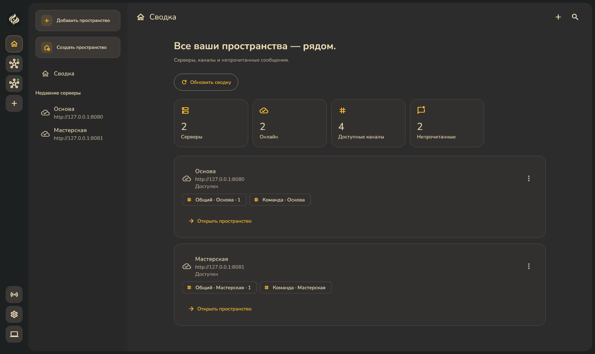
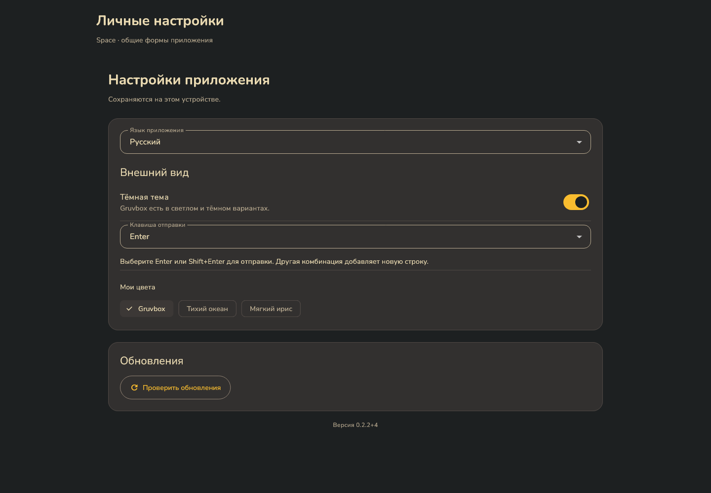
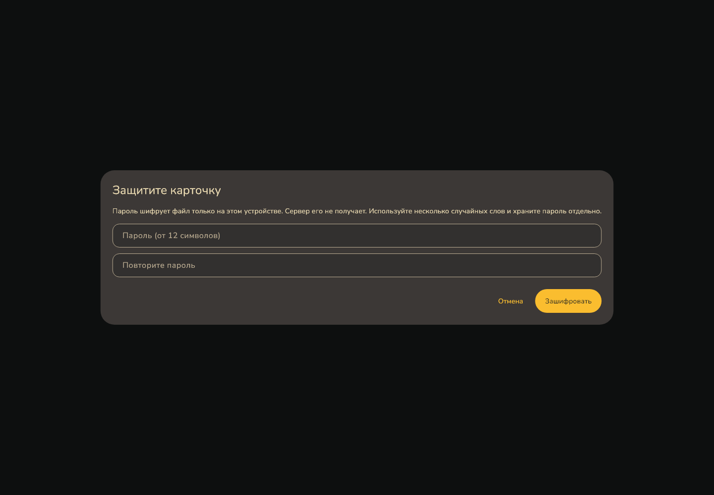
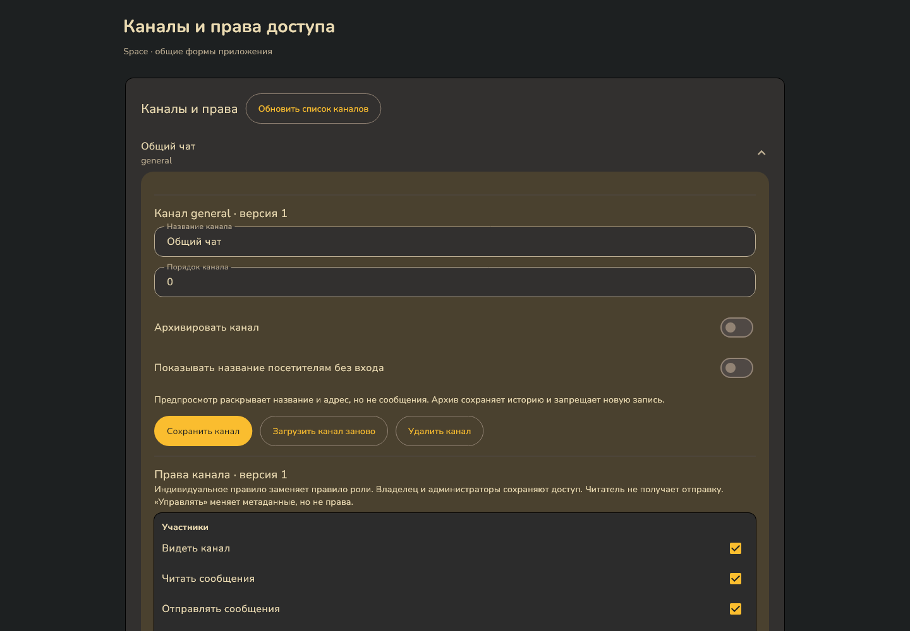
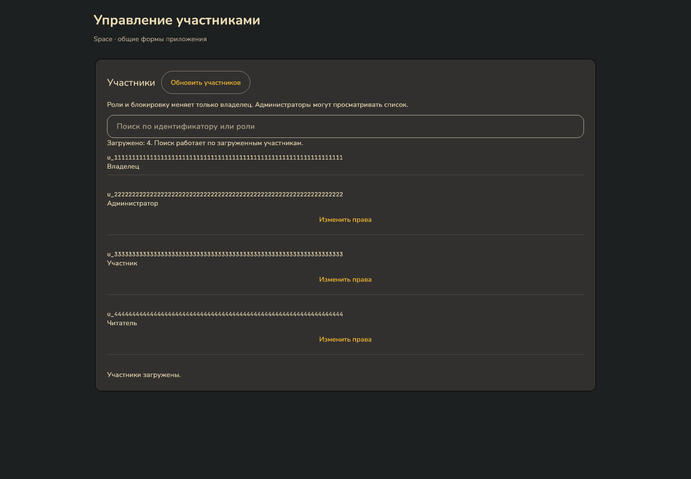
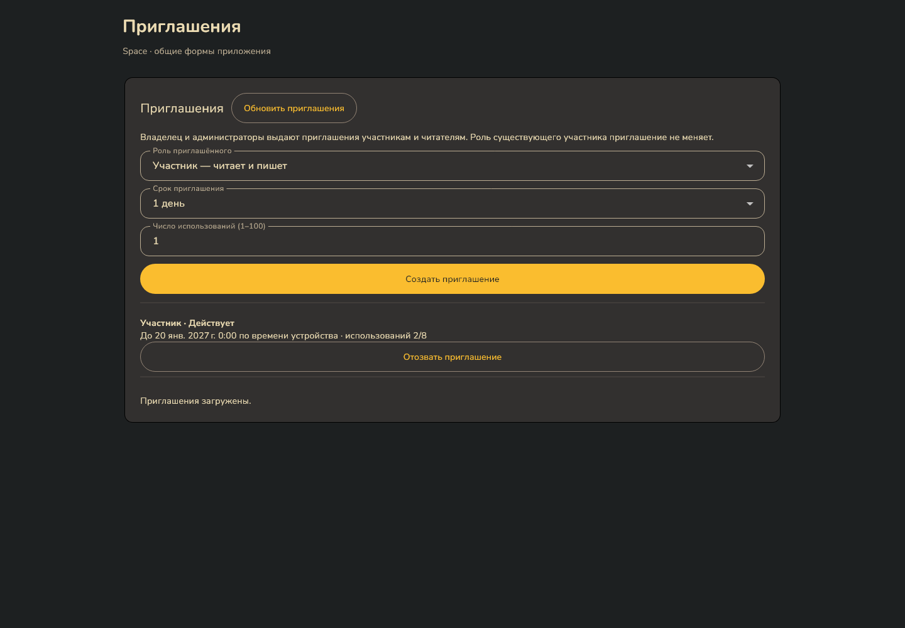
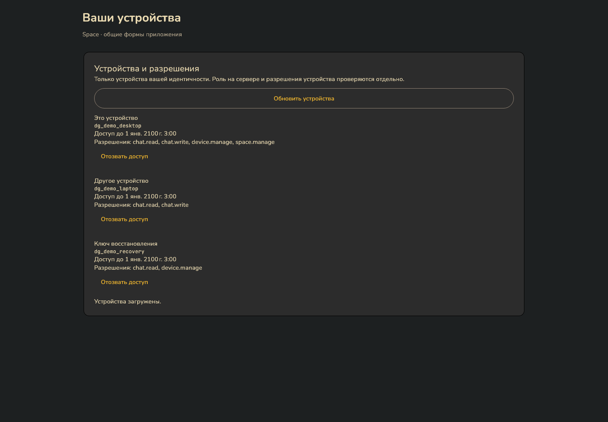
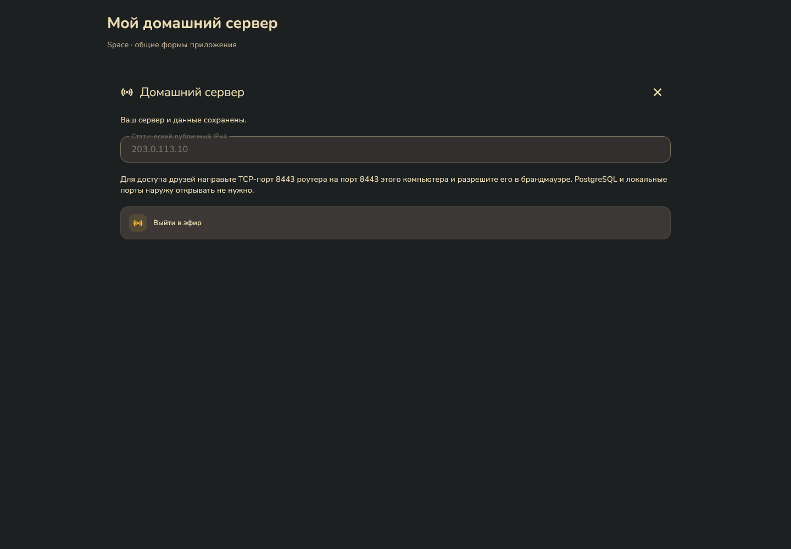
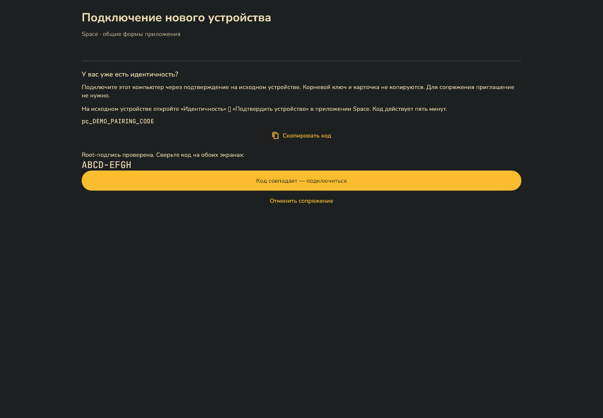

# Интерфейс Space v0.2.2

Актуальный форум v0.7.16: [15 снимков полного Windows-приложения с оболочкой и навигацией](screenshots/forum-reports-app/README.md). Жалобы на темы и ответы, очередь, решения с причиной, скрытый ответ и аудит на широком и узком экранах. Настоящий локальный сервер, PostgreSQL, два участника и вложение.

Снимки обновлены 14 октября 2026 года. Они получены рендерингом текущих Flutter-виджетов с демонстрационными данными. Сводка и чат сняты в основной оболочке, остальные экраны — в изолированной тестовой оболочке общих форм. Настоящие ключи, приглашения и пользовательские сообщения не использованы.

[Скачать приложение](https://github.com/space-protocol-project/space-app/releases/latest) · [Руководство](APPLICATION-GUIDE.md) · [Обновление](APP-UPDATES.md)

## Сводка

## Чат

## Настройки и обновления

## Защита карточки восстановления

## Каналы и права

## Участники

## Приглашения

## Устройства

## Домашний сервер

## Сопряжение

