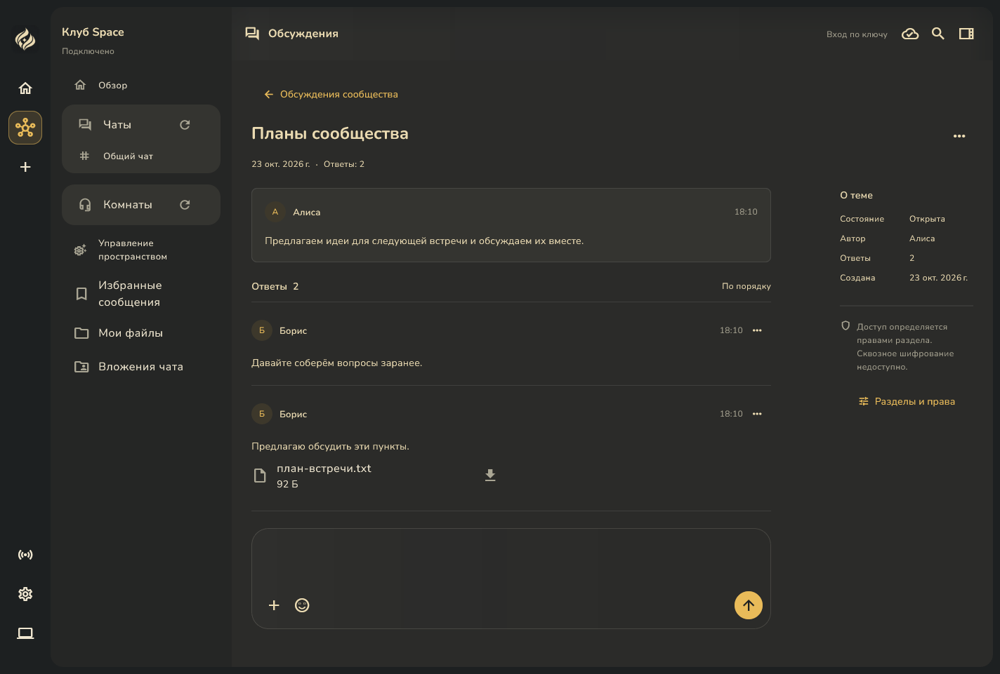

# Модерация форума: полное работающее приложение

23 октября 2026. Снимки запущенного Windows Debug-приложения с полной оболочкой `SpaceApp`: панелью пространств, боковым меню, заголовком и адаптивной навигацией. Использованы настоящий сервер из рабочей копии, PostgreSQL со схемой 29, два сгенерированных участника и настоящий загруженный файл. Данные демонстрационные; пользовательские пространства и ключи для стенда не используются.

Это снимки всей клиентской области Flutter из нативного окна, без системной рамки Windows. Они не собраны из отдельных экранов и не подменяют физическую приёмку Android/macOS/Linux. Широкая клиентская область — 1424×961; компактная — 484×1161. В компактном виде боковое меню открывается отдельно.

| Сценарий | Широкое окно | Компактное окно |
| --- | --- | --- |
| Плотный список тем | [Открыть](forum-topics-desktop.png) | [Открыть](forum-topics-compact.png) |
| Повторно открытая тема с реальным вложением | [Открыть](forum-reopened-desktop.png) | [Открыть](forum-reopened-compact.png) |
| Скрытый ответ | [Открыть](forum-hidden-reply-desktop.png) | [Открыть](forum-hidden-reply-compact.png) |
| Подтверждение с причиной | [Открыть](forum-moderation-reason-desktop.png) | [Открыть](forum-moderation-reason-compact.png) |
| Скрытая тема | [Открыть](forum-hidden-topic-desktop.png) | [Открыть](forum-hidden-topic-compact.png) |
| Журнал модерации | [Открыть](forum-moderation-log-desktop.png) | [Открыть](forum-moderation-log-compact.png) |

[Навигационное меню компактного окна](forum-navigation-compact.png).

## Что проверено при съёмке

- Создание тем, ответы второго участника, закрепление, закрытие и повторное открытие выполняются настоящими RPC.
- Файл загружен вторым участником и виден в открытом ответе. После скрытия ответа скачивание по известному ID возвращает `NotFound` даже владельцу.
- Причина скрытия передаётся из рабочего диалога; журнал загружается с сервера и содержит автора, время и причины действий.
- Восстановление темы сохраняет независимо скрытый ответ скрытым.
- Поле ответа использует общий с чатом ввод: эмодзи, вложения и отправка, без подсказки «Что у вас нового?».

Инструментальный сценарий: [forum_moderation_native_app.dart](../../../client/test/support/forum_moderation_native_app.dart). Он проверяет loopback и ожидаемый server ID, требует новую тестовую схему с первым владельцем, использует ключи и настройки тестового профиля в памяти. Адрес, server ID и каталог снимков передаются через `SPACE_FORUM_NATIVE_ORIGIN`, `SPACE_FORUM_NATIVE_SERVER_ID`, `SPACE_FORUM_NATIVE_OUTPUT` с `--dart-define-from-file`.

Срез пока локальный: опубликованный runtime v0.7.11 со схемой 28 этих операций не содержит; закреплённый каталог runtime не изменён.
