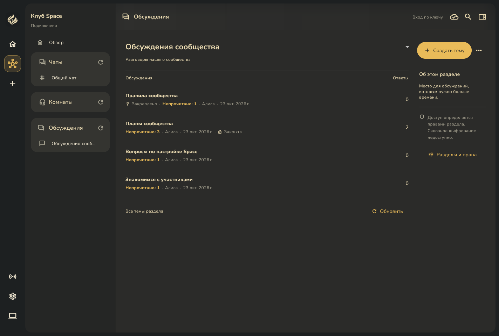
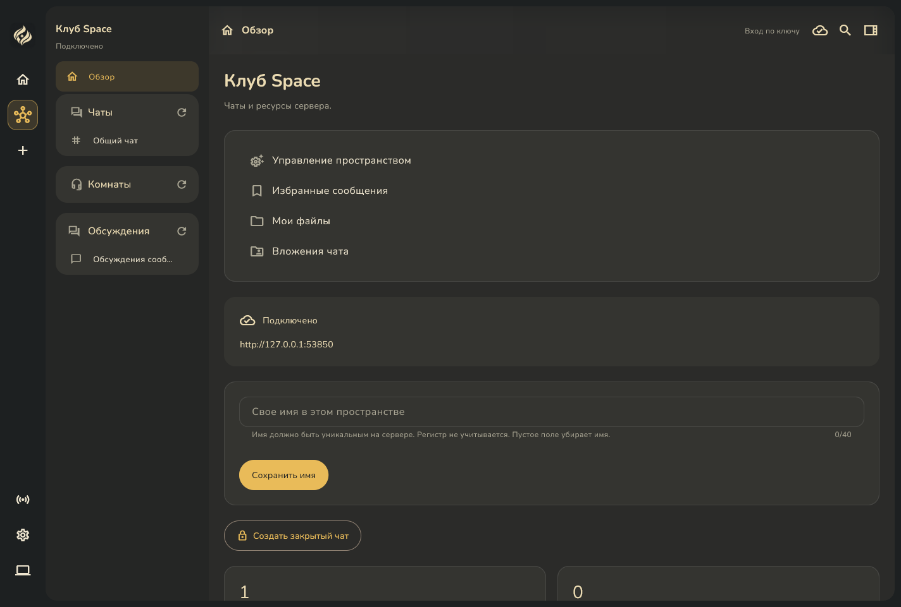

# Обсуждения в навигации Space

23 октября 2026. Снимки полного Windows Debug-приложения с настоящим локальным сервером и отдельной PostgreSQL. Данные тестовые, запросы и вложения настоящие. Захвачена вся клиентская область окна, включая оболочку и навигацию.

В боковой панели появились «Обсуждения» со списком доступных разделов. Управление пространством, избранные сообщения и файловые списки перенесены в «Обзор». Действия сохраняют прежние проверки доступа. Тексты всех трёх заголовков выровнены, кнопки обновления закреплены справа, позиции значков сохранены. Длинные заголовки подстраивают размер шрифта через AutoSizeText; полное название доступно в подсказке.

Между областями чатов, комнат и обсуждений одинаковый отступ 16 пикселей. Переходы между разделами и темами используют появление с небольшим сдвигом за 180 мс; изменение высоты списков тоже плавное. При системном отключении анимаций переходы мгновенные. Предыдущее содержимое не удерживается ради анимации, состояния страниц и черновики сохраняются.

| Экран | Широкое окно | Узкое окно |
|---|---|---|
| Список тем | [Открыть](forum-topics-desktop.png) | [Открыть](forum-topics-compact.png) |
| Открытая тема | [Открыть](forum-reopened-desktop.png) | [Открыть](forum-reopened-compact.png) |
| Скрытый ответ | [Открыть](forum-hidden-reply-desktop.png) | [Открыть](forum-hidden-reply-compact.png) |
| Причина модерации | [Открыть](forum-moderation-reason-desktop.png) | [Открыть](forum-moderation-reason-compact.png) |
| Скрытая тема | [Открыть](forum-hidden-topic-desktop.png) | [Открыть](forum-hidden-topic-compact.png) |
| Журнал | [Открыть](forum-moderation-log-desktop.png) | [Открыть](forum-moderation-log-compact.png) |
| Обзор и перенесённые действия | [Открыть](space-overview-desktop.png) | [Открыть](space-overview-compact.png) |

[Навигация узкого окна](forum-navigation-compact.png).

Подготовлено через [инструментальный запуск полного приложения](../../../client/test/support/forum_moderation_native_app.dart). Windows-снимки не заменяют проверку физических мобильных устройств и экранной клавиатуры.
