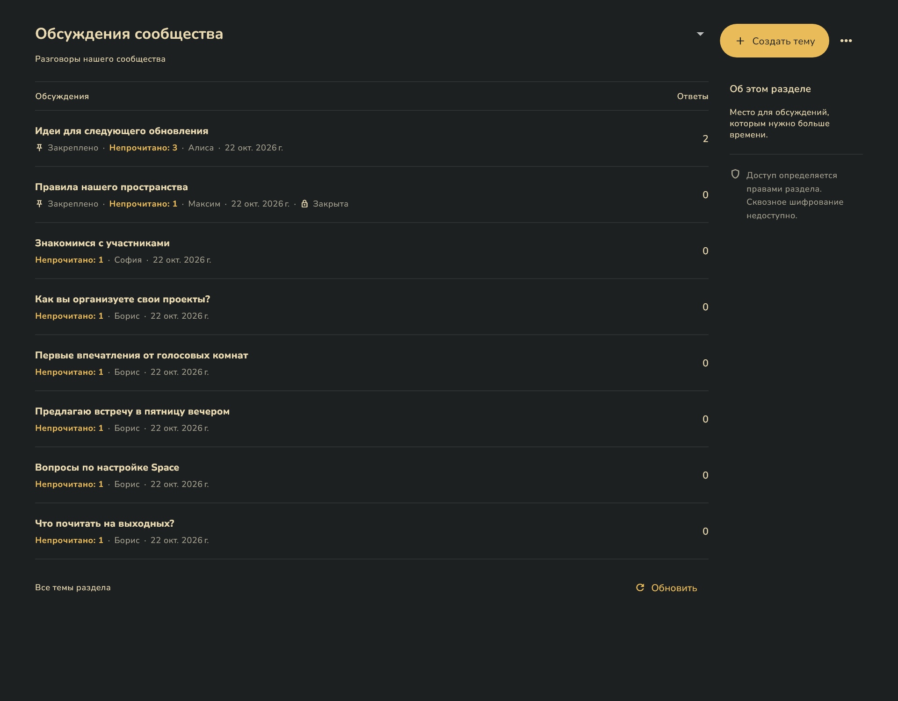
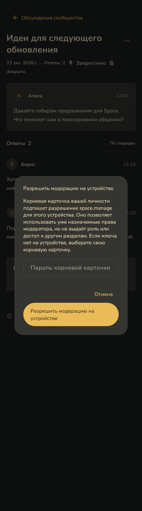

# Форум: закрепления, чтение и устройство модератора

22 октября 2026. Снимки настоящих Flutter-виджетов с демонстрационными данными, без оболочки приложения и без подключения к рабочему сообществу. Это локальный срез схемы 28; опубликованный runtime v0.7.10 его не содержит. Снимки не заменяют ручную приёмку нескольких физических устройств.

| Экран | Широкий | Узкий |
|---|---|---|
| Темы: закрепления и непрочитанное | [PNG](forum-topics-desktop.png) | [PNG](forum-topics-mobile.png) |
| Обсуждение | [PNG](forum-discussion-desktop.png) | [PNG](forum-discussion-mobile.png) |
| Закрытая тема | [PNG](forum-closed-desktop.png) | [PNG](forum-closed-mobile.png) |
| Разрешение устройству модератора | [PNG](forum-device-permission-desktop.png) | [PNG](forum-device-permission-mobile.png) |

Широкая область — 1280×1000, узкая — 390×1400 логических пикселей; PNG с масштабом 1,5. Тёмная палитра Space, русский язык. Форум и чат сохраняют общее поле ответа с эмодзи и вложениями. В диалоге показан вариант выбора собственной корневой карточки; реальные ключи и пароли не использованы.

Повторный экспорт из client: задайте SPACE_FORUM_SCREENSHOTS абсолютным путём и выполните flutter test test/forum_screenshots_test.dart. Без переменной экспорт штатно пропускается.
