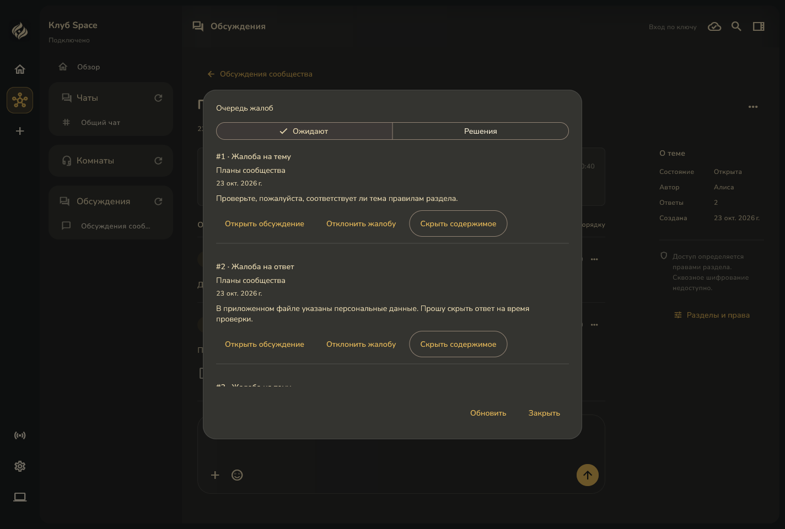
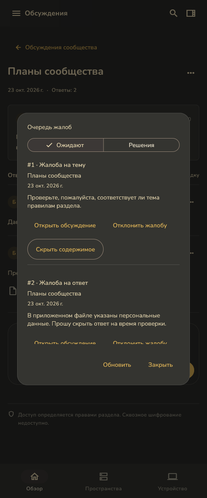
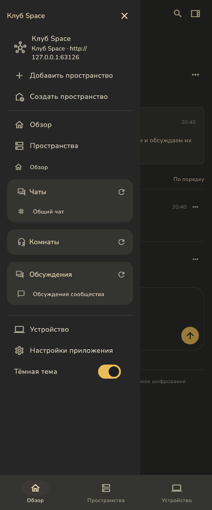

# Жалобы и очередь модерации — полное приложение

23 октября 2026. Windows Debug, рабочий код нового среза со схемой PostgreSQL **30** и `core.forum.reports.v1`. Срез включён в клиент v0.7.16 / runtime v0.7.13. Снимки получены из рабочего кода перед выпуском; предыдущая пара v0.7.15 / v0.7.12 содержит схему 29.

15 снимков всей клиентской области работающего Space: широкое окно **1424×961**, узкое **484×1161**. Видны общая оболочка, заголовок, боковая либо нижняя навигация. Рамка операционной системы не входит в снимок. Узкое окно Windows проверяет адаптивную компоновку, но не заменяет проверку Android и экранной клавиатуры.

Использованы настоящий локальный сервер, отдельная схема PostgreSQL, две тестовые личности и реально загруженное вложение. Тексты и причины демонстрационные. RPC, разрешения, решения и журнал настоящие; исходные данные пользователя не использовались. После скрытия ответа скачивание его файла по известному ID вернуло NotFound.

| Состояние | Широкий экран | Узкий экран |
| --- | --- | --- |
| Список тем и навигация | [Открыть](forum-topics-desktop.png) | [Открыть](forum-topics-compact.png) |
| Причина жалобы на тему | [Открыть](forum-report-form-desktop.png) | [Открыть](forum-report-form-compact.png) |
| Очередь жалоб на темы и ответы | [Открыть](forum-report-queue-desktop.png) | [Открыть](forum-report-queue-compact.png) |
| Решение со скрытием ответа | [Открыть](forum-report-decision-desktop.png) | [Открыть](forum-report-decision-compact.png) |
| История отклонения и скрытия | [Открыть](forum-report-history-desktop.png) | [Открыть](forum-report-history-compact.png) |
| Скрытый ответ в обсуждении | [Открыть](forum-reported-reply-hidden-desktop.png) | [Открыть](forum-reported-reply-hidden-compact.png) |
| Аудит решений с номерами жалоб | [Открыть](forum-report-audit-desktop.png) | [Открыть](forum-report-audit-compact.png) |

Очередь прокручивается: снимок показывает видимую часть, остальные жалобы и решения доступны ниже.

## Очередь в полной оболочке





## Навигация узкого экрана



## Воспроизведение

Сценарий: [forum_reports_native_app.dart](../../../client/test/support/forum_reports_native_app.dart), общий запуск: [forum_moderation_native_app.dart](../../../client/test/support/forum_moderation_native_app.dart). Он использует полноценный SpaceApp и производственные виджеты форума. Снимки снимаются с корневой RepaintBoundary после изменения настоящего окна через window_manager.

Нужны Windows и отдельно запущенный свежий loopback-сервер текущего кода с пустой схемой PostgreSQL. Передайте `SPACE_FORUM_NATIVE_ORIGIN`, `SPACE_FORUM_NATIVE_SERVER_ID` и абсолютный `SPACE_FORUM_NATIVE_OUTPUT` через `--dart-define-from-file`. Сценарий откажется от внешнего сервера или несовпадающего server ID и требует, чтобы новая личность стала владельцем пустого стенда.

Из `client`:

```powershell
flutter run -d windows -t test/support/forum_reports_native_app.dart --dart-define-from-file=<локальный-файл-параметров.json>
```

Завершение подготовки отмечается строкой `FORUM_REPORTS_READY`. Временные сервер и PostgreSQL после проверки останавливаются; пользовательские пространства и ключи не меняются.
