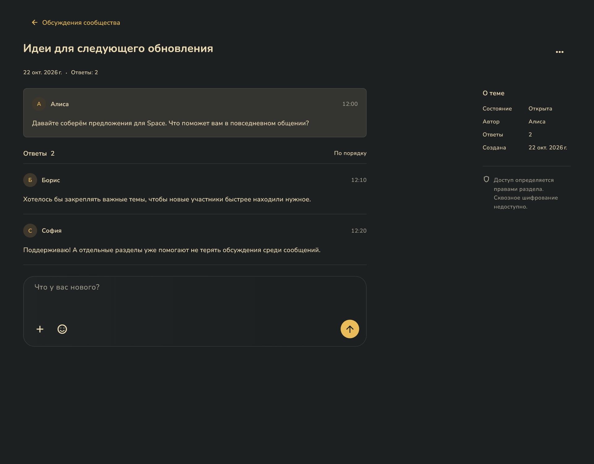
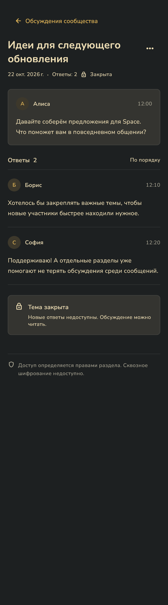

# Форум: плотный интерфейс Flutter

22 октября 2026. Настоящие Flutter-виджеты с демонстрационными участниками и сообщениями. Снимки получены автоматическим рендерингом, без подключения к рабочему серверу. Тёмная тема, русский язык. После реализации нового дизайна снимки обновлены: плотный список, открытая тема с общим полем чата (эмодзи, файлы, отправка) и закрытая тема. Широкий экран: 1280 × 1000; узкий: 390 × 1400 логических пикселей. PNG сохранены с масштабом 1,5.

| Состояние | Широкий экран | Узкий экран |
|---|---|---|
| Список тем | [PNG](forum-topics-desktop.png) | [PNG](forum-topics-mobile.png) |
| Тема и ответы | [PNG](forum-discussion-desktop.png) | [PNG](forum-discussion-mobile.png) |
| Закрытая тема | [PNG](forum-closed-desktop.png) | [PNG](forum-closed-mobile.png) |

Повторное получение: из client задайте SPACE_FORUM_SCREENSHOTS абсолютным путём к выходному каталогу и выполните flutter test test/forum_screenshots_test.dart. Без этой переменной экспорт пропускается в обычном прогоне тестов.
